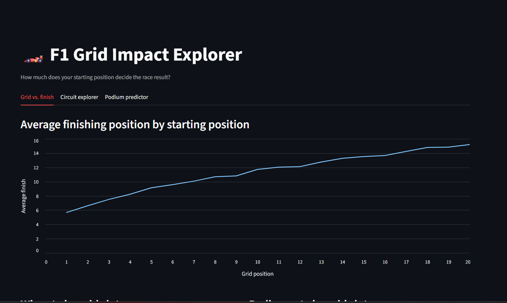
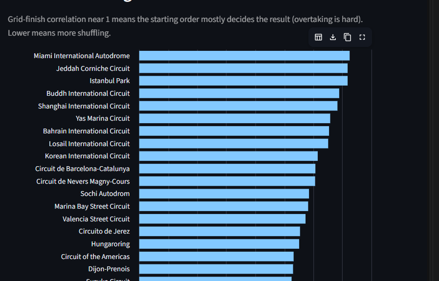
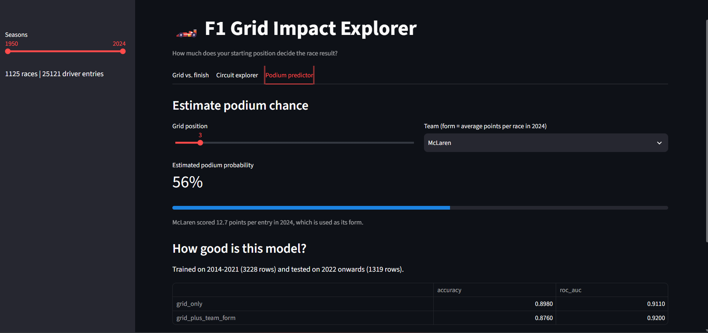

# 🏎️ F1 Grid Impact Explorer

An interactive dashboard that answers one question: **how much does starting position decide the result of a Formula 1 race, and does it vary by circuit?**

Built for the Analytix Club MVP Challenge (theme: Motorsport).

## Purpose
F1 fans often say "qualifying is everything" at Monaco and "anything can happen" at Monza. This project checks those claims with data and lets anyone explore them.

## Who is it for?
F1 fans, students learning data analysis, and anyone curious about race strategy.

## Features
- **Grid vs. finish:** average finish, win rate and podium rate for every starting slot.
- **Circuit explorer:** ranks circuits by how strongly the grid decides the race and compares any two circuits.
- **Podium predictor:** estimates a driver's podium chance from grid position and the team's form (average points per entry in the previous season).
- **Honest evaluation:** the model is trained on 2014-2021 and tested on 2022 onwards, and compared with a grid-only baseline.

## Tech stack
Python, pandas, scikit-learn (logistic regression), Streamlit.

## Dataset
[Formula 1 World Championship](https://www.kaggle.com/datasets/rohanrao/formula-1-world-championship-1950-2020) by Rohan Rao on Kaggle.
Files used: `results.csv`, `races.csv`, `drivers.csv`, `circuits.csv`, `constructors.csv`.

## How to run
```bash
git clone <your-repo-url>
cd f1-grid-impact
pip install -r requirements.txt
```
1. The five CSV files are already in `data/`. If you cloned without them, download the dataset from Kaggle and place them there.
2. Start the app:
```bash
streamlit run app.py
```
Optional: `python model.py` prints the model evaluation in the terminal.

## How it works
1. `data_prep.py` merges the tables, removes pit-lane starts (grid = 0) and creates helper columns (podium, positions gained).
2. Circuit stats use the Spearman correlation between grid and finish, plus the pole-to-win rate.
3. `model.py` trains a logistic regression on 2014 onwards (the hybrid era) using grid position and last season's team form, and tests it on 2022 onwards.
4. `app.py` shows everything in Streamlit.

## Results and findings
- Starting position is a strong predictor: on the 2022+ test set, grid alone reaches ROC AUC 0.911.
- Adding last season's team form improves it to 0.920.
- Adding circuit and team *names* did not help (AUC about 0.90), because team strength changes from season to season. I tried it and removed it.
- Accuracy is less informative than AUC here, since always guessing "no podium" is already about 85% correct.

## Limitations
- `finish` uses the official classification order, so retirements count as low finishes and add noise.
- The model ignores weather, tyre strategy, safety cars and driver skill.
- The dataset version used here covers 1950 to 2024.

## Future improvements
- Add weather and tyre-strategy data (e.g. via the FastF1 library).
- Use qualifying and pit-stop data.
- Try gradient boosting and compare with logistic regression.
- Deploy the app online.

## What I built myself
I chose the Motorsport theme and defined the question: how much does starting position decide an F1 race result, and does it vary by circuit?

**What I did**
- Picked the theme and the question, and found the Kaggle F1 dataset.
- Built the project with AI assistance, then ran it on the real data and fixed the setup problems myself (data folder paths, Python and Streamlit setup).
- Went through the results and the charts to understand what they show, for example why the circuit chart needed to be sorted from highest to lowest.
- Took the screenshots, created the public GitHub repository and pushed the code with Git.

**What I understand and can explain**
- How the five tables are merged and why pit-lane starts (grid = 0) are removed.
- How the circuit score works: a Spearman correlation between grid and finishing position.
- Why the model trains on 2014-2021 and tests on 2022 onwards, so it is judged on unseen seasons.
- Why the team's previous-season points are used as a feature, to avoid data leakage.
- Why ROC AUC is more useful than accuracy here: about 85% of entries do not finish on the podium.

**AI use:** I used an AI assistant to help write and debug the code, as the challenge allows. I reviewed how each part works so I can explain it.

**What I learned:** merging tables with pandas, avoiding data leakage, evaluating a model honestly, building a Streamlit dashboard, and using Git and GitHub.

## Screenshots
### Grid vs. finish


### Circuit explorer


### Podium predictor

